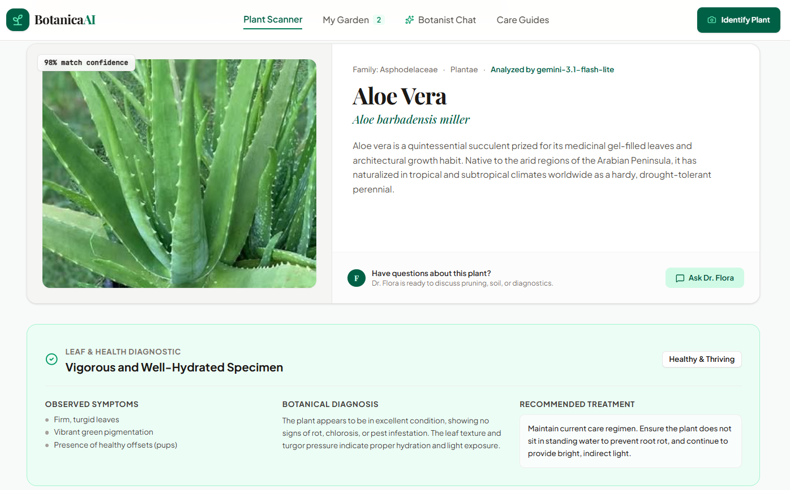
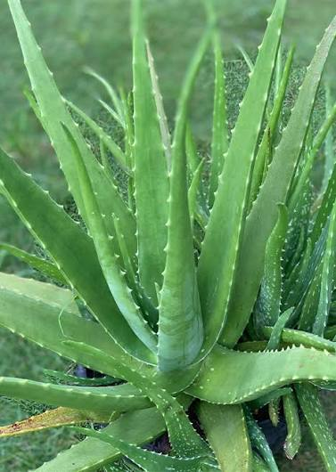
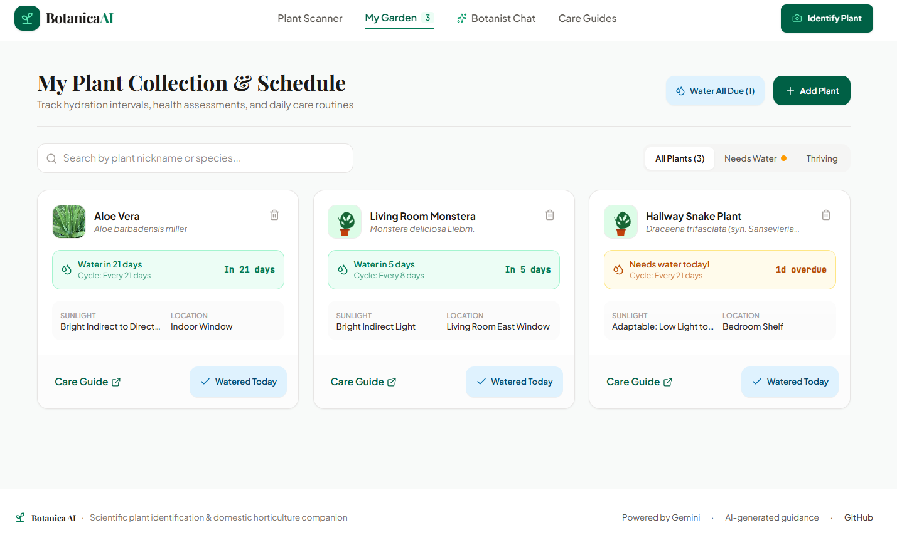
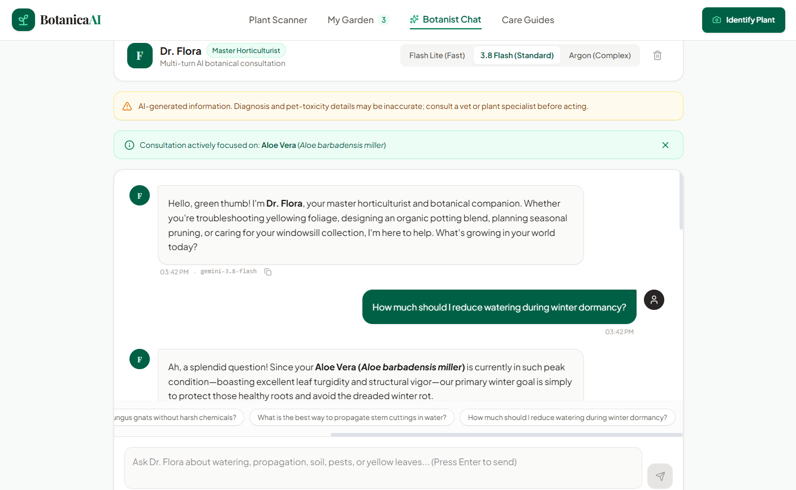
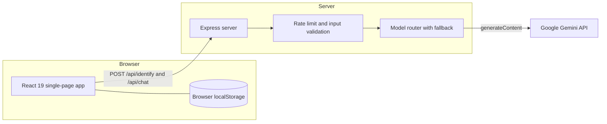
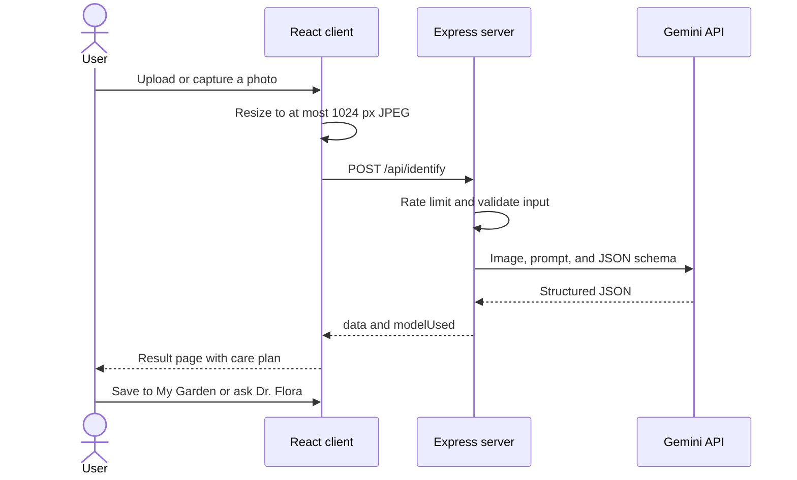

<div align="center">

# Botanica AI — Intelligent Plant Care & Identification

**A full-stack botanical companion: identify a plant from a photo, check its health, get a complete care plan, track watering, and ask an AI horticulturist — all in one app.**

[](https://botanica-ai-mu.vercel.app/)
[](https://github.com/viochris/botanica-ai)
[](https://react.dev/)
[](https://www.typescriptlang.org/)
[](https://tailwindcss.com/)
[](https://expressjs.com/)
[](https://ai.google.dev/)
[](./LICENSE)

<br />



<sub>A scan result: identification, confidence score, the model that produced it, and the leaf health diagnostic.</sub>

<br />

**[Live Demo](https://botanica-ai-mu.vercel.app/)** · **[Overview](#overview)** · **[Problem and Solution](#problem-and-solution)** · **[Features](#features)** · **[Screenshots](#screenshots)** · **[How It Works](#how-it-works)** · **[Getting Started](#getting-started)** · **[API Reference](#api-reference)** · **[Roadmap](#roadmap)**

</div>

---

## Important Notice

* **AI-generated guidance.** Plant identifications, health diagnoses, and care instructions are produced by Google Gemini models. They can be wrong or incomplete. Treat them as a starting point, not as expert advice.
* **Toxicity and pet safety.** Toxicity information (dogs, cats, humans) is informational only and is also AI-generated for scanned plants. If you suspect that an animal or a person has eaten a toxic plant, contact a licensed veterinarian, a physician, or your local poison control center immediately.
* **Photo processing.** Every photo you upload or capture is sent to the Google Gemini API for analysis. Do not upload images that you are not comfortable sharing with that service.

---

## Table of Contents

1. [Overview](#overview)
2. [Problem and Solution](#problem-and-solution)
3. [Features](#features)
4. [Screenshots](#screenshots)
5. [How It Works](#how-it-works)
6. [Tech Stack](#tech-stack)
7. [Project Structure](#project-structure)
8. [Getting Started](#getting-started)
9. [Configuration](#configuration)
10. [Production Build and Deployment](#production-build-and-deployment)
11. [API Reference](#api-reference)
12. [Security and Privacy](#security-and-privacy)
13. [Engineering Challenges and Solutions](#engineering-challenges-and-solutions)
14. [Known Limitations](#known-limitations)
15. [Roadmap](#roadmap)
16. [Troubleshooting](#troubleshooting)
17. [Contributing](#contributing)
18. [License](#license)

---

## Overview

**Botanica AI** is a full-stack web application that turns a single photo of a plant into a structured, readable care guide. A React single-page app handles the interface, camera, and local garden tracking, while a small Express server acts as a secure proxy to the Google Gemini API.

At a glance:

| | |
|---|---|
| **Type** | Full-stack web app (React SPA + Express API proxy) |
| **What it does** | Plant identification, leaf-health diagnosis, 8-point care plan, watering tracker, AI chat, care guides |
| **AI** | Google Gemini via `@google/genai`, with structured JSON output and cascaded model fallback |
| **Languages** | TypeScript (client and server) |
| **Data storage** | None on the server. The garden collection lives in the browser's `localStorage` |
| **Status** | Version 1.0.0, portfolio project |

The project was first scaffolded with Google AI Studio and then reviewed and hardened by hand: dependency conflicts, the production static-file path, input validation, rate limiting, and several UI bugs were fixed. The details are documented in [Engineering Challenges and Solutions](#engineering-challenges-and-solutions).

---

## Problem and Solution

Looking after plants is harder than it looks, especially for beginners. Botanica AI was built around the problems below.

| Problem | How Botanica AI addresses it |
|---|---|
| **"What plant is this?"** Many people own plants without knowing the species, so they cannot search for the right care information. | Upload or capture a photo and receive the common name, scientific name, family, and a model-estimated confidence score (1–100). |
| **Care advice is scattered and generic.** Light, water, soil, humidity, and fertilizer advice is spread across many websites and often ignores the actual species. | One result page presents an **8-point care plan** (sunlight, watering, soil, temperature, humidity, fertilizer, repotting and pruning, toxicity) for the identified plant. |
| **Problems are noticed too late.** Yellow leaves, brown tips, or pests are often spotted only after the plant is already struggling. | A **leaf health assessment** lists observed symptoms, a likely diagnosis, and a recommended treatment, with gentle organic options suggested first. |
| **Pet and household safety.** Many popular houseplants are harmful to cats, dogs, or children. | Toxicity flags for dogs, cats, and humans are shown on every result, together with a safety disclaimer. |
| **Forgetting to water.** Different plants need different watering intervals. | **My Garden** stores saved plants, calculates when each one is due, shows overdue status, and lets you mark plants as watered in one tap. |
| **Follow-up questions.** A static care sheet cannot answer "why are my leaf tips crispy?" | **Dr. Flora**, a multi-turn AI chat, can be focused on the plant you just scanned so that answers stay relevant to it. |
| **Soil mixes and seasonal tasks.** Knowing how much soil, bark, or perlite to buy for a pot is guesswork. | **Care Guides** include a potting-soil calculator, a seasonal calendar, and a leaf-symptom troubleshooter. |

### Design goals

* **Readable first.** Results are broken into clearly labelled cards instead of a wall of text.
* **Safe by default.** The API key never reaches the browser, inputs are validated, and requests are rate limited.
* **Graceful under failure.** If one Gemini model is unavailable or over quota, the server automatically tries the next one.
* **Honest labelling.** The UI shows which model actually produced a result, and sample presets are clearly marked as sample data.
* **Works on a phone.** The layout is responsive, with a bottom navigation bar and native camera support on mobile.

---

## Features

### 1. Multimodal plant identification

* Upload a photo, drag and drop it, take a picture with the live in-browser camera, or use the native phone camera dialog.
* Choose an analysis focus: **Full Identification** or **Leaf Health Focus**.
* Add optional notes (room lighting, watering history, what you have observed) to give the model more context.
* Photos are automatically resized on the client to a maximum of 1024 px (JPEG, quality 0.8) before upload, which keeps requests small and fast.
* Returns common name, scientific (Latin) name, botanical family, a model-estimated confidence score, and a short summary of the plant and its native habitat.
* Six **one-click sample presets** (Monstera, Fiddle Leaf Fig, Snake Plant, Peace Lily, English Lavender, Cherry Tomato) let you explore the app without a camera or an API key.

### 2. Leaf health and disease diagnostic

* Overall status: healthy, needs attention, diseased, or pest-infested.
* **Observed symptoms** (for example leaf-tip browning or yellowing lower leaves).
* **Botanical diagnosis** explaining the likely cause.
* **Recommended treatment**, with gentle organic remedies (adjusting watering, wiping leaves, neem oil) suggested before aggressive chemical options.

### 3. Eight-point care matrix

Each scanned plant gets a structured plan covering:

1. **Sunlight**: light level, hours per day, ideal spot, warning signs.
2. **Watering**: frequency, interval in days, how to check the soil, water quality, seasonal tips.
3. **Soil**: type, drainage needs, recommended mix, ideal pH.
4. **Temperature**: ideal range, minimum safe temperature, frost tolerance.
5. **Humidity**: level, percentage range, misting advice.
6. **Fertilizer**: frequency, NPK ratio, application tips.
7. **Repotting and pruning**: interval, best season, pruning tips.
8. **Toxicity and safety**: flags for dogs, cats, and humans, plus details.

The result page also lists fun botanical facts, common pests and diseases, and propagation methods.

### 4. My Garden: watering tracker

* Save any scanned or preset plant to your collection with one click.
* Each plant shows a watering status such as *Due today* or *3d overdue*, based on its recommended interval.
* **Water All Due** marks only the plants that are due or overdue, so plants that do not need water are left untouched.
* Search by nickname or species, and filter by *All*, *Needs Water*, or *Healthy*.
* Open the full care sheet of a saved plant again, or ask Dr. Flora about it directly.
* The collection is stored in the browser's `localStorage`. If the browser's storage quota is exceeded, a visible warning is shown instead of failing silently.
* A first-time visitor sees two demo plants so that the tab is never empty.

### 5. Dr. Flora: AI botanist chat

* Multi-turn conversation with a warm, practical horticulturist persona.
* **Plant focus:** the plant you just scanned is passed to the chat as context, and a badge shows what the conversation is focused on. You can remove the focus at any time.
* **Three model modes:** Fast (`gemini-3.1-flash-lite`), Standard (`gemini-3.8-flash`), and Complex (`gemini-4-argon`).
* Suggested starter questions, copy-to-clipboard on every answer, and a clear-conversation button.
* Chat history is kept when you switch between tabs while the page stays open.
* Replies are rendered as full Markdown (headings, bullets, numbered lists, bold, italics, code, links, quotes) with `marked`, and the resulting HTML is sanitized with DOMPurify before it reaches the page, so model output cannot inject scripts.

### 6. Care Guides

* **Potting Soil and Amendment Calculator:** choose a pot diameter (4–20 inches) and a soil profile (aroid, succulent and cactus, tropical, or edible herb and vegetable). The app estimates the pot volume and splits it into organic matter, bark, perlite, and worm castings. Volume is an *estimate* that assumes a standard pot height of about 0.9 times the diameter.
* **Seasonal Horticultural Calendar:** tasks for spring, summer, autumn, and winter.
* **Rapid Leaf Symptom Troubleshooter:** a quick reference that links common leaf problems to their usual causes and fixes.

---

## Screenshots

> The scan result is shown at the top of this README. Below are the photo that was used for that demo scan and the other main screens. All images live in the [`img/`](./img) folder.

### Demo input photo



*The aloe vera photo that was uploaded to the scanner to produce the result shown at the top of this page.*

### My Garden and Dr. Flora

| My Garden | Dr. Flora chat |
|:---:|:---:|
|  |  |
| Watering status per plant, search, filters, and the **Water All Due** action. | Multi-turn chat focused on the scanned plant, with Fast, Standard, and Complex model modes. |

---

## How It Works

### Architecture



The browser never talks to Gemini directly. The API key exists only in the server's environment, so it cannot be read from the page, the network tab, or the JavaScript bundle.

### Scan flow



### Structured output

Instead of asking the model for free text and parsing it, the server sends a **response schema** with the request. Gemini must reply with JSON that matches the schema: names, confidence, a health assessment, eight care sections, facts, pests, and propagation methods. The same shape is declared as TypeScript interfaces in `src/types.ts`, so the UI can render each section without guessing.

### Model routing and fallback

| Endpoint | Model selection | Fallback behaviour |
|---|---|---|
| `POST /api/identify` | Fixed order: `gemini-3.1-flash-lite`, then `gemini-3.8-flash`, then `gemini-4-argon` | The next model is tried only if the previous call throws (for example a quota or availability error). |
| `POST /api/chat` | The user picks **Fast** (`gemini-3.1-flash-lite`), **Standard** (`gemini-3.8-flash`), or **Complex** (`gemini-4-argon`). Unknown model names are ignored. | The selected model is tried first, then `gemini-3.1-flash-lite`, then `gemini-3.8-flash`. |

Both endpoints return `modelUsed`, and the UI displays it, so users always see which model produced the answer. The cheapest model is tried first on purpose: it keeps the project usable on a free API tier.

---

## Tech Stack

| Category | Technology |
|---|---|
| **Frontend** | [React 19](https://react.dev/), [TypeScript](https://www.typescriptlang.org/) |
| **Styling** | [Tailwind CSS v4](https://tailwindcss.com/) via `@tailwindcss/vite` |
| **Icons** | [Lucide React](https://lucide.dev/) |
| **Markdown** | [marked](https://marked.js.org/) for rendering, [DOMPurify](https://github.com/cure53/DOMPurify) for sanitizing |
| **Build tooling** | [Vite 8](https://vite.dev/), [esbuild](https://esbuild.github.io/), [tsx](https://github.com/privatenumber/tsx) |
| **Backend** | [Node.js](https://nodejs.org/) and [Express 4](https://expressjs.com/) |
| **AI SDK** | [`@google/genai`](https://www.npmjs.com/package/@google/genai) |
| **Models** | Gemini 3.1 Flash-Lite, Gemini 3.8 Flash, Gemini 4 Argon |
| **Protection** | [`express-rate-limit`](https://www.npmjs.com/package/express-rate-limit), manual input validation, model allowlist, DOMPurify |
| **Configuration** | [dotenv](https://www.npmjs.com/package/dotenv) |
| **Client storage** | Browser `localStorage` |

---

## Project Structure

```text
botanica-ai/
├── img/                        # README images (4 files)
├── src/
│   ├── components/
│   │   ├── Header.tsx          # Top navigation and quick-scan button
│   │   ├── BottomNav.tsx       # Mobile bottom navigation
│   │   ├── PlantScanner.tsx    # Upload, camera, presets, image resizing
│   │   ├── PlantResultView.tsx # Identification result, health, 8-point care matrix
│   │   ├── PlantIllustration.tsx # SVG illustrations for sample presets
│   │   ├── MyGarden.tsx        # Watering tracker with search and filters
│   │   ├── BotanistChat.tsx    # Dr. Flora chat interface
│   │   └── CareGuides.tsx      # Soil calculator, seasonal calendar, troubleshooter
│   ├── data/
│   │   └── samplePlants.ts     # Six curated sample presets
│   ├── App.tsx                 # App state, tab routing, localStorage persistence
│   ├── types.ts                # Shared TypeScript interfaces
│   ├── main.tsx                # React entry point
│   └── index.css               # Tailwind import and custom styles
├── server.ts                   # Express API: /api/identify, /api/chat, /api/health
├── vite.config.ts              # Vite and Tailwind configuration
├── tsconfig.json
├── package.json
├── .env.example                # Environment variable template
├── LICENSE
└── README.md
```

---

## Getting Started

### Prerequisites

* [Node.js](https://nodejs.org/) **20.19+ or 22.12+**
* npm (included with Node.js). The repository also ships a `bun.lock`, so `bun install` works too.
* A Google Gemini API key from [Google AI Studio](https://ai.google.dev/)

### Installation

```bash
# 1. Clone the repository
git clone https://github.com/viochris/botanica-ai.git
cd botanica-ai

# 2. Install dependencies
npm install

# 3. Create your local environment file
cp .env.example .env.local

# 4. Open .env.local and set your key
#    GEMINI_API_KEY="your_actual_gemini_api_key_here"

# 5. Start the development server
npm run dev
```

Open **http://localhost:3000**. In development, the Express server also serves the React app through Vite's middleware, so one command runs everything.

> **Never commit `.env.local`.** It is already listed in `.gitignore`, but run `git status` before your first push to be sure that it does not appear.

### Try it without an API key

The six sample presets, My Garden, and Care Guides work without a key. Only the photo scan and Dr. Flora need `GEMINI_API_KEY`. Without it, those two endpoints return a clear `503` message and the server prints a warning at startup.

---

## Configuration

| Variable | Required | Default | Description |
|---|---|---|---|
| `GEMINI_API_KEY` | Yes, for scan and chat | none | Your Google Gemini API key. Read only on the server. |
| `PORT` | No | `3000` | Port the server listens on. |
| `NODE_ENV` | No | unset | `production` serves the built files from `dist/` instead of running Vite's dev middleware. `npm start` sets it for you through `cross-env`. |
| `APP_URL` | No | none | Listed in `.env.example` for Google AI Studio only. This app does not read it, so you can leave it out. |

Environment files are loaded in this order: `.env.local` first, then `.env`. Real environment variables set by your host take precedence over both files.

### Available scripts

| Command | Description |
|---|---|
| `npm run dev` | Starts the full-stack dev server (Express and Vite middleware) with `tsx`. |
| `npm run build` | Builds the client with Vite and bundles `server.ts` to `dist/server.js` with esbuild. |
| `npm start` | Runs `dist/server.js` with `NODE_ENV=production` already set (through `cross-env`, so it works on Windows, macOS, and Linux). Run `npm run build` first. |
| `npm run lint` | Type-checks the project with `tsc --noEmit`. |
| `npm run clean` | Removes build artifacts. |

---

## Production Build and Deployment

```bash
# 1. Build the client and the server bundle
npm run build

# 2. Start the production server
npm start
```

> **About `NODE_ENV`:** the server uses it to decide between Vite's development middleware and the static files in `dist/`. The `start` script already sets `NODE_ENV=production` through `cross-env`, so no extra setup is needed on any operating system.

### Deploying

Botanica AI is a long-running Node.js server, so it can be hosted on any platform that runs a Node process (for example a VPS, Render, Railway, Fly.io, or Google Cloud Run).

1. Set the build command to `npm run build` and the start command to `npm start`.
2. Set the environment variable `GEMINI_API_KEY` in the platform's settings. Do not put it in the repository.
3. `npm start` sets `NODE_ENV=production` for you. If your platform runs the server some other way, set it yourself.
4. The server calls `app.set('trust proxy', 1)`, so the rate limiter sees each visitor's real IP address when the app runs behind one reverse proxy. If your platform has more than one proxy layer, adjust this value in `server.ts`.
5. **Protect your key.** A public demo spends your quota. Use a dedicated key for the demo and set a quota or budget cap in your Google AI Studio or Google Cloud console.

---

## API Reference

All routes are served by `server.ts`. `/api/identify` and `/api/chat` share one rate limit of **20 requests per 15 minutes per IP address**.

### `GET /api/health`

Returns a simple status object. Useful for uptime checks.

```json
{ "status": "ok", "service": "Botanica AI Backend", "timestamp": "2026-11-01T07:06:23.318Z" }
```

### `POST /api/identify`

Identifies a plant and returns its health assessment and care plan.

**Request body**

```json
{
  "imageBase64": "data:image/jpeg;base64,/9j/4AAQSkZJRg...",
  "mimeType": "image/jpeg",
  "userNotes": "Lower leaves are turning yellow"
}
```

| Field | Type | Required | Rules |
|---|---|---|---|
| `imageBase64` | string | Yes | Base64 image data, with or without the `data:` prefix. Roughly 10 MB maximum. |
| `mimeType` | string | No | `image/jpeg` (default), `image/png`, or `image/webp`. |
| `userNotes` | string | No | At most 500 characters. |

**Success response (abridged)**

```json
{
  "success": true,
  "data": {
    "commonName": "Monstera",
    "scientificName": "Monstera deliciosa",
    "family": "Araceae",
    "confidence": 92,
    "summary": "...",
    "healthAssessment": {
      "status": "healthy",
      "conditionTitle": "...",
      "symptoms": ["..."],
      "diagnosis": "...",
      "treatment": "..."
    },
    "careInstructions": {
      "sunlight": {}, "watering": {}, "soil": {}, "temperature": {},
      "humidity": {}, "fertilizer": {}, "repottingAndPruning": {}, "toxicity": {}
    },
    "funFacts": ["..."],
    "commonPestsAndDiseases": ["..."],
    "propagationMethods": ["..."]
  },
  "modelUsed": "gemini-3.1-flash-lite"
}
```

The full shape is defined by `PlantIdentificationData` in [`src/types.ts`](./src/types.ts).

### `POST /api/chat`

Sends a conversation to Dr. Flora and returns the next reply.

**Request body**

```json
{
  "messages": [
    { "role": "user", "content": "Why are my leaf tips turning brown?" }
  ],
  "model": "gemini-3.8-flash",
  "plantContext": { "commonName": "Peace Lily", "scientificName": "Spathiphyllum wallisii" }
}
```

| Field | Type | Required | Rules |
|---|---|---|---|
| `messages` | array | Yes | 1 to 30 items. Each needs `role` (`user` or `model`) and a string `content` of at most 4000 characters. |
| `model` | string | No | Must be one of `gemini-4-argon`, `gemini-3.8-flash`, `gemini-3.1-flash-lite`. Anything else falls back to `gemini-3.8-flash`. |
| `plantContext` | object | No | The scanned plant's data. Used to focus the conversation. |
| `taskComplexity` | string | No | `general`, `fast`, or `complex`. Overrides `model` when set to `fast` or `complex`. |

**Success response**

```json
{ "success": true, "reply": "...", "modelUsed": "gemini-3.8-flash" }
```

### Error responses

| Status | Meaning | Example message |
|---|---|---|
| `400` | The request failed validation. | `Invalid mimeType. Allowed types are image/jpeg, image/png, or image/webp.` |
| `429` | The rate limit was exceeded. | `Too many requests from this IP, please try again after 15 minutes.` |
| `500` | The AI call failed. Details are logged on the server only. | `Failed to analyze plant photo. Please check your image and try again.` |
| `503` | `GEMINI_API_KEY` is not configured. | `Gemini API key is not configured. ...` |

---

## Security and Privacy

| Area | What is done |
|---|---|
| **API key** | Stored only in server environment variables, never sent to the browser. `.env*` files are git-ignored, and only `.env.example` is tracked. |
| **Abuse protection** | `express-rate-limit` allows 20 requests per 15 minutes per IP on the AI endpoints. `trust proxy` is configured so that limits apply per visitor and not per proxy. |
| **Input validation** | MIME-type allowlist, size limits on images, notes, message count, and message length, and a request body limit of 12 MB. |
| **Cost control** | The client cannot choose arbitrary models. Only three allowlisted model names are accepted. |
| **Error hygiene** | Raw errors from the Gemini API are logged on the server and replaced with generic messages for the client. |
| **XSS safety** | Chat output is parsed as Markdown with `marked`, then sanitized with DOMPurify, which removes scripts, inline event handlers, and unsafe URLs such as `javascript:` links. |
| **Photo privacy** | Photos are forwarded to the Google Gemini API for analysis and are not written to any server-side database. Photos of plants you add to My Garden are stored in your own browser's `localStorage` and can be removed at any time. |
| **Dependencies** | `npm audit --omit=dev` reports 0 known vulnerabilities at the time of writing. |

---

## Engineering Challenges and Solutions

This section records real problems found while building and reviewing the project, and how each one was solved.

| # | Challenge | Solution |
|---|---|---|
| 1 | **Keeping the API key secret** while the app calls an AI service from the browser. | All AI calls go through an Express proxy. The key is read from server environment variables only. |
| 2 | **Unreliable free-tier models.** Quota limits and temporary overloads made single-model calls fail. | Cascaded fallback across three Gemini models, with `modelUsed` returned and shown in the UI. |
| 3 | **Unpredictable AI output** is hard to render. | A response schema forces JSON, and matching TypeScript interfaces make every section type-safe. |
| 4 | **Open endpoints could drain the API quota.** | Rate limiting, strict input validation, a model allowlist, a smaller body limit, and generic error messages. |
| 5 | **Rate limiting behind a proxy** would count every visitor as one IP. | `trust proxy` configuration, verified by sending requests with different `X-Forwarded-For` values. |
| 6 | **Large camera photos** slowed uploads and filled `localStorage` (about 5 MB) quickly. | Client-side canvas resizing to 1024 px JPEG, plus a visible warning when saving to storage fails. |
| 7 | **`npm install` failed with an `ERESOLVE` error.** `esbuild` 0.25 conflicted with the peer requirement of Vite 8. | `esbuild` was raised to `^0.28.0`. |
| 8 | **Production build returned 404.** The bundled server ran from `dist/`, so the static path resolved to `dist/dist`. | The static directory is now resolved from `process.cwd()`. |
| 9 | **API key not loaded locally.** `dotenv` read only `.env` while the docs said `.env.local`. | The server loads `.env.local` first, then `.env`. |
| 10 | **Camera stayed on** after the user switched tabs. | The camera stream is stopped in an effect cleanup when the scanner unmounts. A native-capture fallback covers denied permissions. |
| 11 | **Chat history was lost** when switching tabs. | Chat state was lifted into `App`, so it survives tab changes. |
| 12 | **Misleading labels** claimed a single model analysed every result. | The UI shows the real `modelUsed`, and presets are labelled as sample data. |
| 13 | **"Water All" watered everything**, including plants that were not due. | It now updates only plants that are due or overdue. |
| 14 | **Rendering AI text as HTML** risks script injection. | Replies are rendered as Markdown with `marked`, and the HTML is sanitized with DOMPurify before it is inserted into the page. |

---

## Known Limitations

Being upfront about what the project does not do yet:

* **AI can be wrong.** Misidentification is possible, especially with unclear photos, unusual cultivars, or plants photographed from far away. The confidence score is a model estimate, not a measured accuracy.
* **Toxicity data is not verified** against an authoritative database such as the ASPCA list for scanned plants. Always double-check before relying on it for pet safety.
* **No accounts or cloud sync.** The garden lives in one browser on one device. Clearing site data deletes it.
* **Local photo storage is limited.** Browsers allow only a few megabytes in `localStorage`, so a large collection of photos will eventually hit the quota.
* **In-memory rate limiting.** Counters reset when the server restarts and are not shared across multiple server instances.
* **No automated tests yet.** The project is checked with TypeScript's strict type-checker and manual testing.
* **English-only interface.**
* **Model availability depends on Google.** Model names and free-tier quotas may change over time.

---

## Roadmap

### Completed in 1.0.0

- [x] Photo identification with structured JSON output
- [x] Leaf health diagnosis and eight-point care matrix
- [x] My Garden watering tracker with search and filters
- [x] Dr. Flora multi-turn chat with plant focus and model selection
- [x] Care Guides: soil calculator, seasonal calendar, symptom troubleshooter
- [x] Cascaded model fallback
- [x] Rate limiting, input validation, and model allowlist
- [x] Client-side image resizing and storage-quota warnings
- [x] Responsive layout with mobile bottom navigation

### Planned

- [ ] **Automated tests:** unit tests for the validation and watering logic, and end-to-end tests for the main flows.
- [ ] **Continuous integration:** a GitHub Actions workflow running type-check, build, and tests on every push.
- [ ] **Docker support:** a `Dockerfile` for one-command deployment.
- [ ] **Streaming chat replies** so that Dr. Flora's answers appear as they are generated.
- [ ] **Accounts and cloud sync** so that gardens and photos follow the user across devices (and move photos out of `localStorage`).
- [ ] **Watering reminders** through browser notifications or a progressive web app.
- [ ] **Health history timeline** that tracks how a plant changes between scans.
- [ ] **Verified toxicity data** cross-checked against an authoritative source.
- [ ] **Multi-language support**, starting with Indonesian.
- [ ] **Shared rate limiting** (for example Redis) for multi-instance deployments.
- [ ] **Accessibility audit** covering keyboard navigation, contrast, and screen-reader labels.

Ideas and pull requests for any of these are welcome.

---

## Troubleshooting

| Problem | Likely cause and fix |
|---|---|
| `npm install` fails with `ERESOLVE` | Use a supported Node version and run a plain `npm install`. Avoid `--force`. Make sure `esbuild` is `^0.28.0` in `package.json`. |
| Scan or chat returns *"Gemini API key is not configured"* (503) | `GEMINI_API_KEY` is missing. Create `.env.local` from `.env.example`, add your key, and restart the server. |
| *"Too many requests"* (429) | The limit of 20 requests per 15 minutes per IP was reached. Wait and try again. |
| `npm start` fails or shows a 404 page | The `dist/` folder does not exist yet. Run `npm run build` first (see [Production Build](#production-build-and-deployment)). |
| The live camera does not open | Browsers allow camera access only on `localhost` or HTTPS, and only after permission is granted. The app falls back to the native camera dialog automatically. |
| *"Could not save plant collection"* warning | The browser's storage quota is full. Remove a few plants, or clear old data. |
| Port 3000 is already in use | Start with another port, for example `PORT=3001 npm run dev`. |
| Results look wrong | Retake the photo closer, in natural light, with the leaves clearly visible, and add notes describing what you see. |

---

## Contributing

Contributions are welcome.

1. Fork the repository and create a branch: `git checkout -b feature/your-feature`.
2. Make your changes, then run `npm run lint` and `npm run build`.
3. Commit with a clear message and open a pull request describing what changed and why.

Please open an issue first for larger changes so that the approach can be discussed. Bug reports are welcome at the [issue tracker](https://github.com/viochris/botanica-ai/issues).

---

## License

Released under the [MIT License](./LICENSE).

---

<div align="center">

Built by [@viochris](https://github.com/viochris)

🌿 **[Live Demo](https://botanica-ai-mu.vercel.app/)** · 🐙 **[GitHub Repository](https://github.com/viochris/botanica-ai)** · 🐛 **[Report an Issue](https://github.com/viochris/botanica-ai/issues)**

</div>